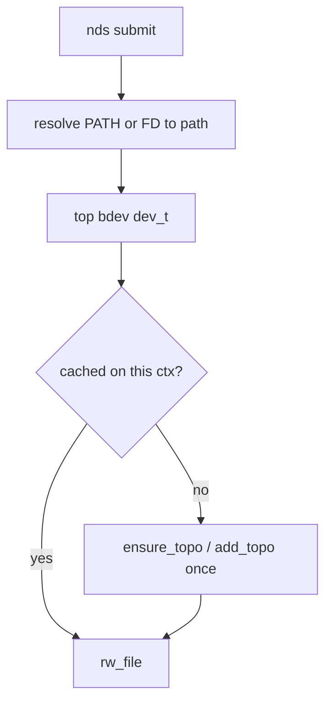

# Change: per-ctx `add_topo` caching in NDS

> **Superseded.** Topology registration moved to `nds_init` (once per process,
> on `book_fd`) and the per-ctx cache was removed. See
> [fix3.md](fix3.md) for the current design; this document is kept only as
> history of the intermediate approach.

This document is part of the [p2p_api](../p2p_api.md) design.  It records a
narrow userspace-only fix: stop calling `add_topo` on every NDS submit; cache
successful topology registration **per `nds_io_ctx`**.

Related contract: [objects.md](objects.md) §5 / §5.1 (already specifies this
behavior; the implementation does not yet).

## Overview

Today [`nds_api.c`](../../file_p2p/nds_api.c) calls `ensure_topo_for_path()` on
**every** `nds_io_submit` / sync I/O path.  That re-issues `IOCTL_ADD_TOPO`
(userspace discovery + ioctl) even when the same ctx already pinned the same
top device.

**Only change:** cache successful (or `-EEXIST`) topo registrations on the
ctx, keyed by top `dev_t`, for the lifetime of that ctx.

## Non-goals (explicit)

- **Do not** change kernel `IOCTL_ADD_TOPO` or `topo_user_cfg`.
- **Do not** change `add_topo(int p2p_fd, const char *dev)` signature or
  userspace discovery.
- **Do not** remove `NDS_IO_OBJ_PATH` (or renumber object types).
- **Do not** introduce a process-global topo cache (each ctx has its own
  `p2p_fd` and must pin for itself).

## Locked behavior

- Cache lives on `struct nds_io_ctx` (destroyed with `nds_io_destroy`).
- Key: top block `dev_t` derived the same way `ensure_topo_for_path` already
  resolves (block path → that device; regular file → `st_dev` / underlying
  bdev).
- Miss → call existing `ensure_topo_for_path` / `add_topo`; on success or
  `-EEXIST`, record the `dev_t`.
- Hit → skip the ioctl entirely.
- New ctx always registers again for its own `p2p_fd`.

## Implementation outline

1. Extend `struct nds_io_ctx` with a small list or array of registered
   `dev_t` (≤ a few entries is enough for v1; dynamic list is fine).
2. Refactor `ensure_topo_for_path` to take `ctx` (or a cache helper): check
   cache → else add → append on success.
3. Wire the same helper from sync `nds_io_pread` / `nds_io_pwrite` if they
   also call ensure today.
4. Optionally note in [objects.md](objects.md) that the gap is closed; no
   UAPI doc churn.

## Acceptance

- Repeated I/O on the same ctx and same top device does not repeat
  `IOCTL_ADD_TOPO` after the first success.
- A second ctx still successfully `add_topo`s the same device for its own
  `p2p_fd`.
- Existing NDS / basic / stress tests still pass; PATH and FD objects both
  still work.
