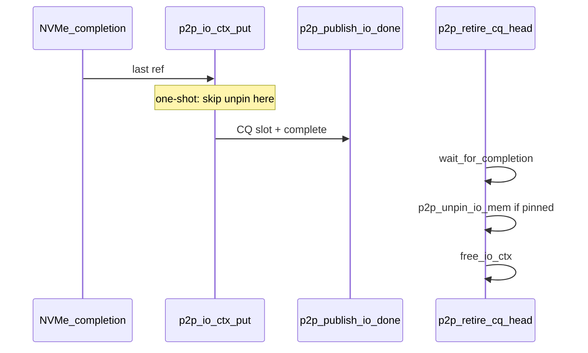

# fix4 — CQ lock cleanup and completion-path audit

Status: design record for the post–Phase-1 CQ/AIO lock split in [`dev.c`](../../dev.c).
Depends on [`completion_getevents.md`](completion_getevents.md) (Phase 1 complete:
`completion_lock` vs `ring_lock`, drain wait-then-harvest, no `on_batch`).
This document records an external review verdict and the next kernel cleanup
items. **Code changes are specified here but not yet required to land as a
single patch** — implement Change A/B/C and the docs-only items below when
scheduling fix4 work.

## Scope

- Audit lock contention, redundant structures, and completion-path hazards
  after the CQ refactor.
- Propose concrete kernel cleanups in [`dev.c`](../../dev.c) and documentation
  updates in [`completion_getevents.md`](completion_getevents.md) and
  [`nds_api.h`](../../file_p2p/nds_api.h).
- **Out of scope:** Phase 2 (`completion_getevents.md` §7) CAS/sharded publish,
  UAPI changes, NDS merge/`sub_ios` semantics, `nds_init` mutex (already
  documented in fix3).

## Verdict summary

### Locks

| Item | Verdict | Action |
| --- | --- | --- |
| `completion_lock` multi-producer | Accept | Same limitation as AIO; Phase 2 only |
| `ring_lock` | Accept | Single consumer by design; not a bottleneck |
| `io_lock` / `io_list` | **Remove** | Replace with `atomic_t io_cnt`; delete lists and lock |
| `waitqueue` | Accept | Keep `wake_up` outside `completion_lock` (AIO-shaped) |

### Redundancy

| Item | Verdict | Action |
| --- | --- | --- |
| Error extraction duplicated | **Fix** | `p2p_io_ctx_errno()` shared by fill + retire |
| `pr_err` per sub-I/O | **Fix** | Log once at publish (or put→publish boundary) |
| `free_io_ctx` double-unpin | Accept | Keep as `-EAGAIN` safety net; clarify in comment |

### Hazards and semantics

| Item | Verdict | Action |
| --- | --- | --- |
| `devmm_put_mem_pa_list` in softirq | **Fix** | Defer one-shot unpin to process context (retire) |
| drain holds `ring_lock` while sleeping | Accept | Document: no concurrent destroy + getevents |
| Empty queue, `min_nr > 0` | Accept | Document: no wait when `outstanding_events == 0` |
| CQ full `WARN_ON_ONCE` | Accept | Keep as safety rail |
| finalize worker comment | Trivial | Clarify comment; order unchanged |

**Core conclusion:** the lock split is at AIO mainline level. The highest-value
cleanup is dropping redundant `io_lock`/`io_list` on the submit path. The
highest-value correctness fix is deferring one-shot unpin out of the NVMe
completion (softirq) path.

---

## Current state (reference)

After Phase 1 ([`completion_getevents.md`](completion_getevents.md) §6):

```text
submit (process)     completion (IRQ/softirq)     harvest (process)
────────────────     ────────────────────────     ─────────────────
io_lock:             completion_lock:              ring_lock (mutex):
  io_cnt++             write CQ slot                  copy_to_user
  list_add             smp_wmb; cq_tail++             retire slot; free ctx
                       atomic_add ready_events
                     (then complete(io_done))
```

`io_list` on `p2p_batch` and `p2p_io_context` is never walked — only
`INIT_LIST_HEAD`, `list_add_tail`, and `list_del_init` appear in
[`dev.c`](../../dev.c). `io_cnt` caps accepted CQ slots (`P2P_CQ_SIZE`);
`outstanding_events` counts logical I/Os (sub_ios) separately.

---

## Change A — Drop `io_lock` / `io_list`

### Problem

`p2p_issue_prepared` and `p2p_retire_cq_head` take `io_lock` with
`spin_lock_irqsave` to update `io_cnt` and link/unlink `io_list`. The list
carries no information (no drain walk, no debug iterator). `outstanding_events`
is already `atomic_t`. Submit pays for irq-disable and lock acquisition on every
accepted I/O without semantic benefit.

### Target structure

Remove from `struct p2p_batch`:

- `struct list_head io_list`
- `spinlock_t io_lock`

Remove from `struct p2p_io_context`:

- `struct list_head io_list`

Change `unsigned int io_cnt` → `atomic_t io_cnt` (accepted CQ slots not yet
retired).

Keep `atomic_t outstanding_events` and `atomic_t ready_events` unchanged.

### Capacity protocol (submit)

Replace the locked increment with an atomic cap check:

```c
if (atomic_inc_return(&batch->io_cnt) > P2P_CQ_SIZE) {
	atomic_dec(&batch->io_cnt);
	/* rollback io_ctx allocation; return -EAGAIN */
}
atomic_add(nr_subs, &batch->outstanding_events);
/* no list_add */
```

Retire (`p2p_retire_cq_head`):

```c
atomic_dec(&batch->io_cnt);
```

Drain / release wait loop:

```c
while (atomic_read(&batch->io_cnt))
```

Use `atomic_read` everywhere `READ_ONCE(batch->io_cnt)` appears today.

### Semantics preserved

- `-EAGAIN` when more than `P2P_CQ_SIZE` accepted slots are in flight
  (published or not yet retired).
- `outstanding_events` still tracks logical completions for `p2p_cq_ready`
  and getevents `min_nr`.
- No change to `completion_lock` or `ring_lock` behavior.

### Non-goals for Change A

- Do not merge `io_cnt` with `outstanding_events` (different units: CQ slots
  vs logical I/Os).
- Do not reintroduce a list “for drain” — drain uses wait-then-harvest on the
  CQ ([`completion_getevents.md`](completion_getevents.md) §6.2).

---

## Change B — Defer one-shot unpin to process context

### Problem

Non-CRC completion path:

```text
p2p_complete_io (IRQ/softirq)
  → p2p_io_ctx_put
      → p2p_unpin_io_mem (one-shot)
          → p2p_put_pinned_pa
              → p2p_mem_put_pa_list → devmm_put_mem_pa_list
      → p2p_publish_io_done
```

`devmm_put_mem_pa_list` may not be safe in softirq context. This predates the
CQ refactor but remains true in the current tree.

Registered memory uses `percpu_ref_put` on the same path; that remains
acceptable on the completion path (fix4 does not move registered unpin).

### Target behavior



**Non-CRC, one-shot (`!reg_mem`):** leave `pinned_mem.pinned == true` through
`p2p_io_ctx_put` and `p2p_publish_io_done`. Unpin in `p2p_retire_cq_head`
(or a shared helper called only from retire/drain harvest) **after**
`wait_for_completion(&io_ctx->io_done)` and before `free_io_ctx`.

**Registered (`reg_mem`):** keep `percpu_ref_put` in `p2p_io_ctx_put` before
publish (unchanged).

**CRC / `DUMP_CONTENT` read path:** keep unpin in `p2p_finalize_io_work`
(process context via `schedule_work`); worker then calls `p2p_publish_io_done`.
Do not add a second unpin at retire for contexts that already unpinned in the
worker.

**`-EAGAIN` / submit failure:** `free_io_ctx` must still unpin when the I/O
never reached the CQ (existing safety net).

### Invariants

- DMA is finished before `p2p_io_ctx_put` runs (last request completion).
- Harvest waits on `io_done` before freeing — publish’s `complete()` is the
  last touch of `io_ctx` fields other than `pinned_mem` on the one-shot defer
  path.
- `free_io_ctx` remains idempotent (`if (!pinned) return`).

---

## Change C — Error helper and single `pr_err`

### Problem

`p2p_fill_io_event` and `p2p_retire_cq_head` duplicate:

```c
err = io_ctx->issue_err;
io_err = io_ctx->io_err;
if (io_err && !err) {
	pr_err("I/O error status %d errno %d\n", ...);
	err = blk_status_to_errno(io_err);
}
```

For a merged `io_ctx` with `nr_subs > 1`, getevents logs the same line once per
expanded event; drain logs again in retire.

### Target

Add:

```c
static int p2p_io_ctx_errno(const struct p2p_io_context *io_ctx);
```

- Pure read of `issue_err` / `io_err`; **no logging**.
- Used by `p2p_fill_io_event` and `p2p_retire_cq_head`.

Log once when the error is first observed — recommended site: end of
`p2p_io_ctx_put` immediately before `p2p_publish_io_done` (only when the
final ref is dropped and `issue_err || io_err`). Alternative: first line inside
`p2p_publish_io_done` under a `WARN_ONCE`-style guard per `io_ctx`; pick one
site in implementation, not both.

---

## Docs-only (no kernel logic change)

### destroy ∥ getevents

[`nds_api.h`](../../file_p2p/nds_api.h): document that `nds_io_destroy_ctx` and
`nds_io_getevents` must not run concurrently on the same `nds_io_ctx`.
`destroy` issues `IOCTL_DRAIN_IO`, which holds `ring_lock` and may sleep until
all I/O completes; a concurrent getevents on the same fd blocks until drain
finishes.

NDS v1 assumes one thread (or external serialization) per ctx for destroy vs
harvest. This matches fix3 “caller owns the ctx”.

### Empty queue, `min_nr > 0`

[`completion_getevents.md`](completion_getevents.md) §6.3 and NDS header:
when `outstanding_events == 0`, `p2p_cq_ready` returns true immediately
(`ready == outstanding`). getevents then harvests zero events and returns `0`
without sleeping — even if `min_nr > 0` and `timeout_ns < 0`.

This differs from Linux AIO `io_getevents` on an empty context with
`min_nr > 0`, which blocks until timeout. Document explicitly; no kernel
change required unless product later demands AIO-identical blocking.

---

## Non-goals

- Phase 2: CAS or sharded `completion_lock`, mmap CQ.
- Changing `completion_lock` irqsave or producer barrier rules.
- UAPI or `p2p_io_param` / `sub_ios` layout changes.
- Process-wide `nds_init` mutex (documented in fix3).
- Removing `WARN_ON_ONCE` on CQ ring fullness.

---

## Acceptance criteria

### Code (Change A/B/C)

- [ ] No `io_lock`, `io_list` in `p2p_batch` / `p2p_io_context`.
- [ ] `atomic_t io_cnt`; submit `-EAGAIN` unchanged under load.
- [ ] One-shot unpin only in process context (retire, finalize worker, or
      failed-submit `free_io_ctx`).
- [ ] Single `pr_err` per failed `io_ctx`; `p2p_io_ctx_errno()` used in fill
      and retire.
- [ ] CRC build (`KCFLAGS=-DCALC_CRC32`) still passes read finalize path.

### Tests

- [ ] KASAN: `basic_test.sh`, `nds_api_test --mode reject` (C + Python).
- [ ] nokasan: `perf_bw_test.sh` or `nds_bw_bench` smoke (32K qd128) — no
      regression vs pre-fix4 submit/harvest behavior.
- [ ] Optional: stress threaded getevents (existing `nds_api_test` modes) on
      kasan after Change A.

### Documentation

- [ ] This file (`fix4.md`) merged.
- [ ] [`completion_getevents.md`](completion_getevents.md) §6.2/§6.3 cross-links.
- [ ] [`nds_api.h`](../../file_p2p/nds_api.h): destroy ∥ getevents note (when
      implementing docs-only item).

---

## Relationship to other design docs

| Doc | Relationship |
| --- | --- |
| [`completion_getevents.md`](completion_getevents.md) | Phase 1 target; fix4 is follow-up cleanup |
| [`fix3.md`](fix3.md) | NDS API contract; fix4 docs-only items extend header comments |
| [`fix1.md`](fix1.md) | Superseded history only |

## Implementation order (recommended)

1. **Change C** — low risk, reduces log noise; good first patch.
2. **Change A** — submit-path performance; independent of B.
3. **Change B** — correctness; test carefully on one-shot and registered paths.
4. **Docs-only** — can land with B or immediately after.
